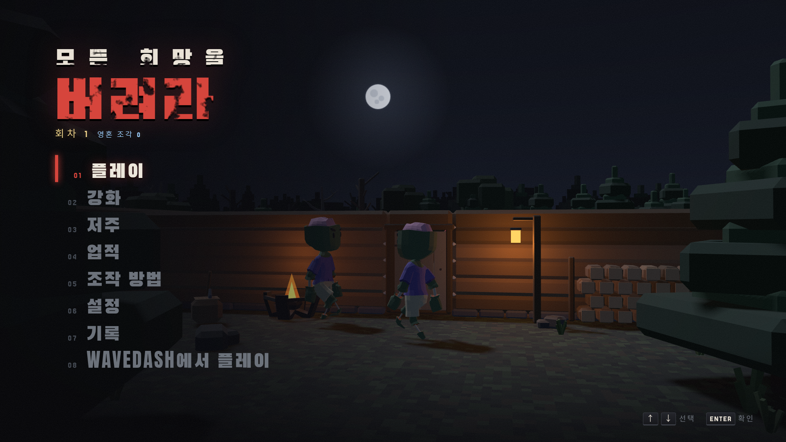
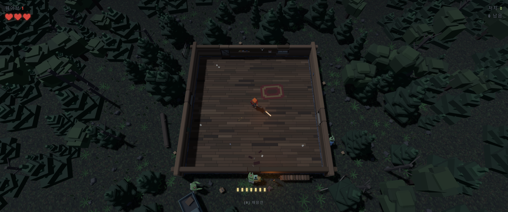
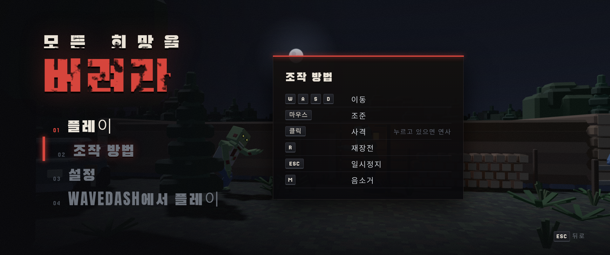
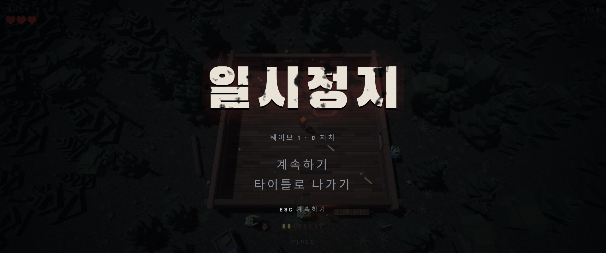

# 🧟 모든 희망을 버려라

### ABANDON ALL HOPE

**밀려오는 언데드를 버텨라. 죽고, 강해지고, 다시 도전하라.**

3D 좀비 서바이벌 슈터 · 웨이브 · 보스전 · 영구 강화 · 다회차

 

 

---

## 🎮 한눈에 보기

| | |
| --- | --- |
| 🌊 **웨이브 서바이벌** | 웨이브가 오를수록 좀비가 몰려오고, 클리어할 때마다 업그레이드 카드를 고릅니다 |
| 👹 **적 4종 + 보스** | 좀비 · 스켈레톤 · 작은 괴물, 5웨이브마다 보스, 20웨이브엔 최종 보스 |
| 🔫 **무기 4종** | 권총 · 샷건 · 소총 · 저격총 (웨이브 진행으로 해금) |
| 🔁 **다회차** | 클리어하면 더 강한 다음 회차로. 영혼 조각으로 영구 강화 |
| 📱 **모바일 지원** | 가상 스틱 터치 조작 |
| 🏆 **기록과 업적** | 최고 기록, 상위 5개 플레이, 업적 10종 |

 

## 📸 스크린샷

<table>
  <tr>
    <td align="center"> <b>게임 플레이</b></td>
    <td align="center"> <b>조작 방법</b></td>
  </tr>
  <tr>
    <td align="center"> <b>일시정지</b></td>
    <td align="center"> <b>타이틀</b></td>
  </tr>
</table>

 

## ⌨️ 조작법

### PC

| 동작 | 입력 |
| :--- | :--- |
| 이동 | `W` `A` `S` `D` |
| 조준 | 마우스 |
| 사격 | 마우스 클릭 (누르고 있으면 연사) |
| 재장전 | `R` |
| 무기 교체 | `1` `2` `3` `4` 또는 마우스 휠 |
| 수류탄 | `G` (주변 적에게 범위 피해) |
| 일시정지 | `ESC` |
| 음소거 | `M` |

### 모바일

터치 화면에서는 터치 UI가 자동으로 나타납니다.

| 동작 | 입력 |
| :--- | :--- |
| 이동 | 화면 왼쪽 드래그 (가상 스틱) |
| 조준 · 사격 | 화면 오른쪽 드래그 (누르고 있는 동안 연사) |
| 무기 교체 · 수류탄 · 재장전 · 일시정지 | 화면의 버튼 |

 

## 🔫 무기

| 무기 | 해금 | 특징 |
| :--- | :---: | :--- |
| 권총 | 시작 | 기본 무기, 안정적인 성능 |
| 샷건 | 웨이브 3 | 근거리 산탄, 거리가 멀수록 피해 감소 |
| 소총 | 웨이브 6 | 빠른 연사, 큰 탄창 |
| 저격총 | 웨이브 9 | 높은 피해, 여러 적을 관통 |

무기 상자를 주워도 해금됩니다. 적이 떨어뜨리는 **탄약 상자 · 응급 키트 · 수류탄 · 더블 데미지 · 무한 탄창**으로 위기를 넘기세요. 아이템은 약 12초 뒤 사라지고, 보스는 항상 아이템을 떨어뜨립니다.

 

## 🌊 웨이브와 적

- **웨이브 테마**: `좀비 떼` · `해골 습격` · `괴물 무리` · `어둠 속에서` 중 하나가 웨이브마다 정해지고, 5의 배수 웨이브는 `보스전`입니다.
- **적 종류**: 느리지만 끈질긴 좀비, 빠르고 약한 스켈레톤, 떼로 몰려오는 작은 괴물, 덩치 큰 보스.
- **업그레이드**: 웨이브를 클리어하면 카드 3장 중 하나를 고릅니다 (확장 탄창, 관통탄, 산탄, 응급 처치 등).

 

## 🔁 다회차 · 영구 강화

> 죽는 것은 끝이 아니라 준비입니다.

| 시스템 | 설명 |
| :--- | :--- |
| 🏁 **최종 보스** | 웨이브 20의 최종 보스를 쓰러뜨리면 승리. `다음 회차로`를 고르면 더 강해진 적과 함께 새 회차가 시작됩니다 |
| 💀 **영혼 조각** | 사망 · 승리 · 타이틀로 나갈 때 웨이브, 처치 수, 보스 처치에 따라 획득 (회차마다 +35%) |
| 💪 **강화** | 체력 · 탄창 · 재장전 · 이동 속도 · 치명타 · 드롭률 · 시작 수류탄 · 시작 무기 · 선택지 확장 — 영혼 조각으로 영구 구매 |
| 🩸 **저주** | 빠른 적 · 체력 증가 적 · 탄창 감소 · 짙은 어둠 · 일격사. 켜면 어렵지만 영혼 조각 보너스. 회차를 클리어할수록 해금 |
| 🏆 **업적** | 첫 보스 처치, 웨이브 10 도달, 무피해 5웨이브, 첫 클리어 등 10종 |

 

<b>🛠 디버그 파라미터 (주소 뒤에 붙이기)</b>

 

| 주소 뒤에 붙이기 | 효과 |
| :--- | :--- |
| `?wave=N` | N번째 웨이브부터 시작 (예: `?wave=5` 첫 보스) |
| `?weapons=all` | 무기 4종 모두 해금, 수류탄 3개 지급 |
| `?touch=1` | PC에서 터치 UI 강제 표시 |
| `?seed=N` | 웨이브 테마 순서 고정 |
| `?soul=N` | 영혼 조각을 N개로 설정 (강화 · 저주 확인용) |

`?wave=N`, `?weapons=all`로 시작한 플레이는 기록 · 영혼 조각 · 업적에 반영되지 않습니다.

예) [웨이브 6 + 모든 무기](https://sigco3111.github.io/abandon-all-hope-game/?weapons=all&wave=6) · [터치 UI 확인](https://sigco3111.github.io/abandon-all-hope-game/?touch=1)

 

## 🧰 기술 스택

- HTML / CSS / JavaScript (단일 `index.html`)
- [three.js](https://threejs.org/) 0.160.0 (import map, GLTFLoader)
- Google Fonts: Anton, Jersey 25, Jim Nightshade, Black Han Sans, Noto Sans KR
- GitHub Pages 배포
- 기록 · 강화 · 업적은 브라우저 `localStorage`에 저장 (서버 없음)

 

## 🙏 크레딧

- **원작**: [Josh Werner](https://codepen.io/editor/joshwerner/pen/01a18d27-5cbe-77c4-9685-9f3836db15e6)의 CodePen "Abandon All Hope (Game)"
- **한글화 및 고도화**: [sigco3111](https://github.com/sigco3111)
- **3D 에셋** (모두 CC0): [Kenney](https://kenney.nl) · [Kay Lousberg (KayKit)](https://kaylousberg.com) · [Quaternius](https://quaternius.com) — 모아 둔 에셋은 [assets-3d-lowpoly](https://github.com/sigco3111/assets-3d-lowpoly), 사용 내역은 [`assets/models/license.txt`](assets/models/license.txt)

 

## 🗺 로드맵

- [x] 한글화
- [x] 애니메이션 좀비 · 새 적 · 보스
- [x] 배경 소품과 조명
- [x] 무기 4종과 아이템
- [x] 기록 저장 · 모바일 터치 · 웨이브 테마
- [x] 다회차 · 영구 강화 · 저주 · 업적
- [ ] 효과음 · 음악 다듬기
- [ ] 밸런스 조정과 번역 다듬기

원작자의 작품을 바탕으로 만든 팬 프로젝트입니다.

